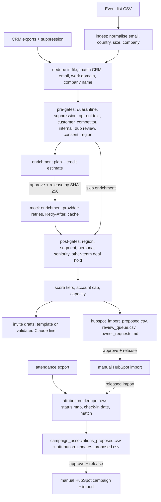

# Architecture

## Stages and data contracts

| Stage | Input | Output | Deterministic? |
|---|---|---|---|
| plan | candidates, CRM exports, manifest | `state.json` checkpoint, `enrichment_request.json`, trace | yes |
| enrich | released request, enrichment CSV | `enrichment_results.json`, `state/enrichment_cache.json` | yes (mock) |
| build | checkpoint, results | target list, review queue, import, drafts, owner requests, brief | yes, except optional model line |
| attribute | attendance, CRM re-export, optional released plan run | associations, attribution updates, review, brief | yes |

Every run directory has `manifest.json` with input hashes (paths relative to the run), artifact hashes and which artifacts are approvable.

## Why AI is used only where it is

Who gets invited, deduped, held or attributed is a policy question with legal and commercial consequences. Those rules have to be replayable and testable, so they live in code. The model's only job is the one place where language actually matters: a short personal line in an invite draft. It sees structured fields and screened text, and its output is validated. Any failure falls back to a template.

## Controls

- **Gate order** saves money. Excluded rows are never enriched (9 credits planned against 35 for "enrich every incomplete row" on the sample, using the per-field assumption in `policy.json`).
- **Approval** binds to file SHA-256, a named approver allowed for that artifact, a 72-hour TTL and a fresh snapshot. Releasing re-hashes the file. Agent identities are blocked.
- **Idempotency**: the enrichment cache is keyed by domain, the invite ledger by event and email, and attribution skips contacts already associated with the campaign.
- **Resume and replay**: `build` resumes from `state.json` after a crash. Same inputs give byte-identical artifacts (failure suite F13). Changed inputs are refused.
- **Privacy**: `decisions.jsonl` stores pseudonymised subjects (`e_` plus a truncated SHA-256), never raw emails or note text. Quarantined text never reaches the model.
- **Permission boundary**: the code contains no HTTP client for CRM or enrichment APIs. A test checks for common write paths.
